# make a mark

  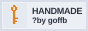&nbsp;
  &nbsp;
  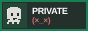&nbsp;
  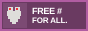&nbsp;
  &nbsp;

  make a mark is a simple tool for creating modern 88x31 badges for websites, readmes and more.

  <a href="https://makeamark.cc/" target="_blank" rel="noopener noreferrer"><strong>website</strong></a>
  &nbsp;|&nbsp;
  <a href="LICENSE"><strong>license</strong></a>

## badge styles

| classic | custom |
|:---:|:---:|
|  |  |

## palettes & characters

**15 palettes:** teal, pink, green, yellow, orange, purple, blue, red, slate, gray, plum, sage, petrol, brick, beige.

**18 characters:** cat, fox, ghost, eye, star, skull, heart, mail, onigiri, torii, mushroom, key, bear, mug, dpad, gift, duck, bug.

## custom palettes

custom palettes give you full creative control. by matching certain color variables (like blending your character into the background), you can mask elements and craft minimalist badges. want just text? yeah, you can do that too. but remember: this only masks elements and doesn’t remove them from the svg code.

&nbsp;
&nbsp;
&nbsp;
&nbsp;

 

[explore them at makeamark.cc →](https://makeamark.cc/)

## little tricks

- write anything in the subtitle — domain, name, symbols, etc.
- keep it short — 8 characters for titles, 18 for classic subtitles, 9 for custom. 
- badges are svgs — use them anywhere you like.

## example: sage palette with custom badge style

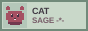&nbsp;
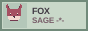&nbsp;
&nbsp;
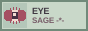&nbsp;
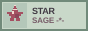&nbsp;
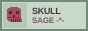&nbsp;
 
&nbsp;
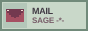&nbsp;
&nbsp;
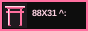&nbsp;
&nbsp;
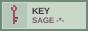&nbsp;
 
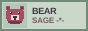&nbsp;
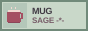&nbsp;
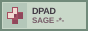&nbsp;
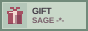&nbsp;
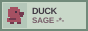&nbsp;
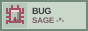&nbsp;

