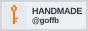
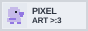
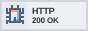
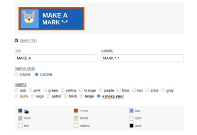

**[makeamark.cc](https://makeamark.cc/)** · **[about](https://makeamark.cc/about.html)** · **[license](LICENSE)**

  &nbsp;
  &nbsp;
  &nbsp;

  a simple tool for creating modern 88x31 badges for websites and readmes.

## badge styles

| classic | custom |
|:---:|:---:|
|  |  |

## palettes & characters

**15 palettes:** teal, pink, green, yellow, orange, purple, blue, red, slate, gray, plum, sage, petrol, brick, beige.

**18 characters:** cat, fox, ghost, eye, star, skull, heart, mail, onigiri, torii, mushroom, key, bear, mug, dpad, gift, duck, bug.

## custom palettes

custom palettes give you full creative control. you can make your custom palette with a few clicks.

 

**[explore everything and create your 88x31 badge at makeamark.cc](https://makeamark.cc/)**