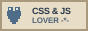

#  make a mark

  

  &nbsp;
  &nbsp;
  

  make a mark is a simple tool for creating modern 88×31 badges for websites, readmes, and more.

  <a href="https://makeamark.cc/" target="_blank" rel="noopener noreferrer"><strong>website</strong></a>
  &nbsp;|&nbsp;
  <a href="LICENSE"><strong>license</strong></a>

## badge styles

| classic | custom |
|:---:|:---:|
|  |  |
|  |  |

## palettes & characters

**15 palettes:** teal, pink, green, yellow, orange, purple, blue, red, slate, gray, plum, sage, petrol, brick, beige.

**15 characters:** cat, fox, ghost, eye, star, skull, heart, mail, onigiri, torii, mushroom, key, bear, mug, dpad.

[explore them at makeamark.cc →](https://makeamark.cc/)

## little tricks

- use anything in the subtitle — a domain, a name, or symbols.
- keep it short — 8 characters for titles, 18 for classic subtitles, and 9 for custom.
- badges are SVGs — use them anywhere you like.